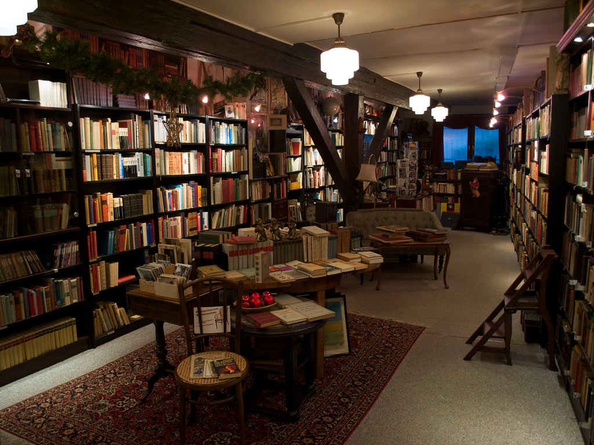

# Mood board: Antikvariaatti Vanha Sivu

## Feeling

**Welcoming, traditional, trustworthy.**

Antikvariaatti Vanha Sivu is a local second-hand bookshop in Ähtäri, Finland, run by bookseller Erkki Lahti. Because the shop serves a wide mix of casual readers, rare-book collectors, and local residents, the website needs to feel warm and approachable rather than cold or overly technical. At the same time, the layout should reflect the quiet, nostalgic atmosphere of printed paper and classic bookshelves while remaining clean, predictable, and easy to scan on any device.

## Colours

The palette builds on the client's chosen brand colours—deep plum, soft white, and antique gold—adjusted so every text and background combination meets WCAG AA accessibility standards (at least **4.5 : 1** contrast) in both light mode and dark mode.

| Name | Hex | Role & Reasoning |
| :--- | :--- | :--- |
| Deep plum | `#301934` | Primary brand colour for headings, links, primary call-to-action buttons, and active navigation tabs in light mode. It evokes classic leather-bound book covers and literary depth. |
| Dark ink | `#1f1222` | Main body text on soft white surfaces. Chosen instead of pure black to feel softer like printed ink on aged paper while keeping crisp legibility. |
| Soft white | `#f8f5fa` | Main page background in light mode and primary text colour in dark mode. Gives a warm, paper-like reading surface without harsh glare. |
| Pure white | `#ffffff` | Card, header, form, and footer surfaces in light mode to create gentle visual separation from the page background. |
| Antique gold | `#c9971a` | Used for decorative borders, form accents, and keyboard focus outlines in light mode, and promoted to the primary brand accent colour in dark mode. |
| Deep aubergine | `#180d1a` | Main page background when the user's device prefers dark mode (`prefers-color-scheme: dark`), paired with `#241427` for elevated surfaces. |

### Contrast Verification (4.5 : 1 Minimum)

* **Light mode body text:** Dark ink (`#1f1222`) on Soft white (`#f8f5fa`) = **17.3 : 1** (Passes).
* **Light mode headings & links:** Deep plum (`#301934`) on Soft white (`#f8f5fa`) = **15.7 : 1** (Passes).
* **Dark mode body text:** Soft white (`#f8f5fa`) on Deep aubergine (`#180d1a`) = **17.3 : 1** (Passes).
* **Dark mode headings & links:** Antique gold (`#c9971a`) on Deep aubergine (`#180d1a`) = **7.6 : 1** (Passes).
* **Design adjustment note:** Because antique gold (`#c9971a`) on soft white (`#f8f5fa`) only reaches 2.56 : 1 contrast, it is restricted to non-text borders and outlines in light mode and only used for text against dark aubergine backgrounds.

## Fonts

* **Headings (`Georgia, "Times New Roman", serif`):** A classic serif typeface chosen for the shop title and section headings. Serif letterforms naturally connect with printed books, antiquarian traditions, and storytelling, giving the site character without needing heavy graphics.
* **Body text & UI (`system-ui, -apple-system, sans-serif`):** A clean, neutral system sans-serif used for paragraphs, navigation links, forms, and buttons. It keeps longer descriptions and catalogue information effortless to read on small phone screens (`320 px`) as well as wide desktop monitors. Using native system fonts also avoids external requests to third-party font servers (supporting GDPR privacy and fast loading on slow mobile networks).

## References

* [Antikvaari.fi](https://antikvaari.fi) – Inspires the straightforward catalogue and search structure, making it simple for visitors to search by title or author without unnecessary distractions.
* [Antikvariaatti Scriptorium](https://scriptorium.fi) – Demonstrates how a traditional Finnish antiquarian bookshop can balance its shop identity and history with direct access to its book selection.
* [Lukulaari](https://lukulaari.fi) – Inspires the friendly, welcoming tone of the homepage and clear, accessible contact options for customers looking for specific titles.
